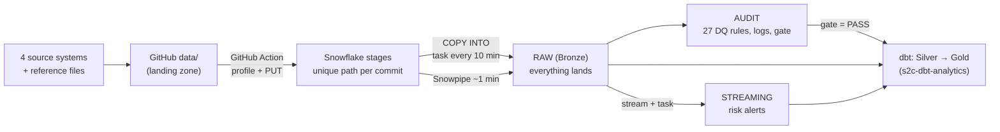

# s2c-snowflake-data-source

**Source-to-Contract (S2C) procurement data platform: sources, ingestion and audit layer on Snowflake.**

A fictional *Sample pharmaceutical company* buys from 200+ suppliers. Its procurement data lives in four systems that deliver files in five formats, some daily, some as a live stream, some typed by hand in Excel. This repo is everything up to the point where dbt takes over: realistic source files, a GitHub landing zone, Snowflake ingestion (batch + Snowpipe), and an audit layer that logs every problem before anything is transformed.

The dbt models, KPIs and question banks live in the companion repo **[s2c-dbt-analytics](https://github.com/diponkarsinha/s2c-dbt-analytics)**.

> All data is synthetic. No real company, supplier or person is represented.

---

## Architecture



**Medallion** layers (Bronze here, Silver/Gold in dbt), **Lambda** processing (batch + speed layer), and **land everything, validate after**: nothing is rejected at the door, every issue is traceable to the file, row and Git commit it came from.

Details: [docs/architecture.md](docs/architecture.md)

## Sources

| System | Entities | Formats | Load |
|---|---|---|---|
| SAP ERP | PO lines, invoices, supplier master, cost centres, FX rates | CSV `;` with decimal comma, Parquet, XML IDoc, CSV, XML | Batch |
| Ariba Sourcing | Sourcing requests, events, bids, awards | Paginated JSON, nested JSON | Batch |
| Ariba Contracts | Contracts, amendments, approvals | Nested JSON, CSV | Batch |
| Supplier Risk | Weekly risk + ESG, risk score events | JSON, **NDJSON stream** | Batch + **Stream** |
| Reference | Category taxonomy, savings tracker | CSV, **Excel** | Batch |

[Data catalog](docs/data_catalog.md) · [Data dictionary](docs/data_dictionary/README.md) · [ER diagram](docs/source_er_diagram.md) · [Source-to-target mapping](docs/source_to_target.md)

## What makes it realistic

- **214 planted issues** with an answer key ([answer_key/planted_issues.csv](answer_key/planted_issues.csv)): duplicate suppliers under new IDs, blocked suppliers still receiving POs, closed cost centres, orphan invoices, credit memos, reversals, overlapping contracts, mixed boolean types, a TOTAL row in Excel, dd/mm dates, missing FX rates...
- **12 drop waves** pushed one at a time to test the pipeline: duplicates (three kinds), bad rows, late data, SCD2 changes, schema drift, empty and huge files, out-of-order / duplicate / invalid stream events ([drop plan](docs/drop_plan.md))
- **A self-checking audit layer**: `scripts/check_planted.py` compares what was planted with what Snowflake caught

## Test results (all 12 waves run end to end)

| Wave | Scenario | Result |
|---|---|---|
| 01 | Normal daily batch | 53 PO lines + 60 invoices loaded; row counts verified; dbt merged only new rows |
| 02 | Risk stream + spike | Snowpipe loaded 41 events; HIGH_RISK + SCORE_JUMP alerts for the 2 -> 8 supplier |
| 03 | Exact duplicate file | Landed, flagged AUD-F02, Gold unchanged |
| 04 | Same content, new name | MD5 caught it (AUD-F04); load history alone would not |
| 05 | Same name, new content | Correction loaded, never silently skipped (AUD-F03); latest SAP change date wins |
| 06 | Bad rows | File landed; 4 rows quarantined, encoding WARN, volume WARN |
| 07 | Late / changed / deleted | 30 late invoices flagged and picked up; deletes flagged, not removed |
| 08 | Supplier master changes | SCD2 versions in snap_sap_suppliers; new duplicate merged by VAT |
| 09 | Schema drift | Renamed + new column: load did not fail, drift flagged, new column read by dbt |
| 10 | Contract updates | SCD2 status history for 10 contracts; 3 API pages flattened |
| 11 | Empty / header-only / 19,354-row file | Logged, volume WARN, bulk file reached Gold |
| 12 | Stream chaos | 5 events dead-lettered; out-of-order event did not overwrite or alert; late event flagged |

**Answer-key check:** 214 planted issues: 37 caught by the audit/stream layer, 177 covered by dbt tests, **0 missed**.

**Real issues found while testing:** Snowpipe records paths relative to the pipe folder (gate blocked until the rule was fixed); a correction file carried an older SAP change date (documented "latest change date wins" rule); a load ran before the upload finished (wait for the Action).

## Repository layout

```text
.github/workflows/ingest.yml   push to data/ -> upload to Snowflake
data/initial/                  first load (Jan-Oct 2026), all sources
data/incoming/                 waves land here when dropped
pending/                       12 waves waiting to be dropped (git-ignored, re-generated)
answer_key/                    planted_issues.csv, waves.json
generator/                     generate_data.py (seeded), build_docs.py
scripts/                       ingest_files.py, file_profiler.py, drop_wave.py, run_sql.py, check_planted.py
snowflake/                     01-11 setup scripts in run order + ops/ (resume, suspend, status, reset)
docs/                          architecture, catalog, dictionary, DQ rules, decisions, runbook, setup
```

## Quick start

```bash
pip install -r requirements.txt
python generator/generate_data.py --clean      # build all data (needs pyarrow for Parquet)
# Snowflake: run snowflake/01 as ACCOUNTADMIN, then 02-11 as S2C_ADMIN
# GitHub: add 3 secrets, push -> the Action uploads data/initial
python scripts/drop_wave.py 1 --push           # drop the first wave
```

Full step-by-step guide: **[docs/github_setup.md](docs/github_setup.md)**

## Snowflake objects

| Schema | Highlights |
|---|---|
| `RAW` | 13 Bronze tables (VARCHAR / VARIANT + `_FILE_NAME`, `_FILE_ROW_NUMBER`, `_FILE_CONTENT_KEY`, `_LOADED_AT`), 5 file formats, 2 stages, Snowpipe, stream |
| `AUDIT` | File registry, pre-load checks, load log (from `COPY_HISTORY`), 27 DQ rules, failing records, pipeline gate, lineage views, task graph |
| `STREAMING` | `RISK_CURRENT` (event-time MERGE), `RISK_ALERTS`, `RISK_DEAD_LETTER`, `RISK_EVENT_LOG` |
| `GOVERNANCE` | Email masking policy, PII tag |

Roles: `S2C_ADMIN`, `S2C_LOADER` (GitHub service user, key-pair auth), `S2C_TRANSFORMER` (dbt), `S2C_ANALYST`, `S2C_PII_READER`. Cost: XS warehouse, 60 s auto-suspend, 20-credit resource monitor.

## Documentation

| Doc | What's in it |
|---|---|
| [architecture.md](docs/architecture.md) | Flow diagrams, layers, batch and stream sequences, data-loss defences, cost |
| [data_catalog.md](docs/data_catalog.md) | Source inventory, formats, Snowflake object catalog |
| [data_dictionary/](docs/data_dictionary/README.md) | Every column of every source, with samples and known issues |
| [source_er_diagram.md](docs/source_er_diagram.md) | Source ER model and the S2C chain |
| [source_to_target.md](docs/source_to_target.md) | RAW → dbt staging mapping |
| [dq_rules.md](docs/dq_rules.md) | All 27 audit rules + pre-load and stream checks |
| [drop_plan.md](docs/drop_plan.md) | The 12 waves and planted issues |
| [scenario_matrix.md](docs/scenario_matrix.md) | Waves → practice topics; interview questions → where to look |
| [decision_log.md](docs/decision_log.md) | 16 design decisions with trade-offs |
| [runbook.md](docs/runbook.md) | Operating, troubleshooting, production checklist |
| [github_setup.md](docs/github_setup.md) | Zip → running pipeline, step by step |

## Roadmap

- **Phase 2:** CI checks on pull requests (sqlfluff, pytest), Streamlit-in-Snowflake DQ dashboard
- **Phase 3:** Azure ADLS Gen2 landing + Snowpipe auto-ingest (Event Grid); Airflow DAG orchestrating upload → load → DQ → dbt
