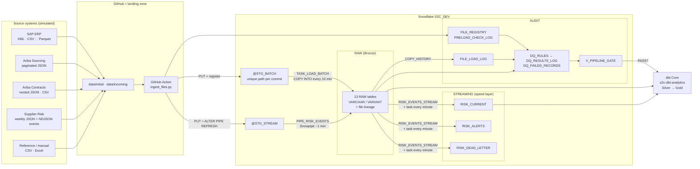
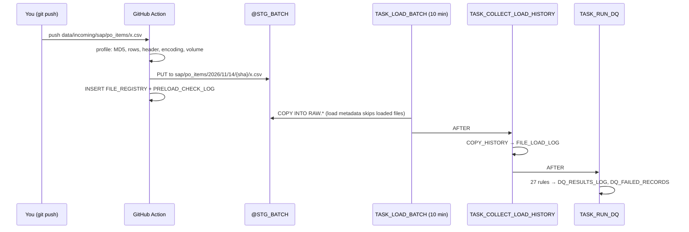
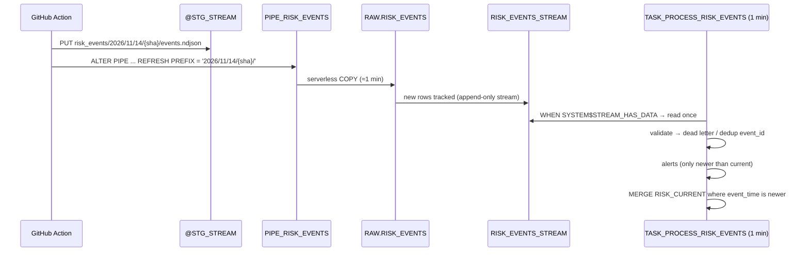

# Architecture

## In one sentence

GitHub is the landing zone that accepts anything; every file lands in Snowflake RAW untouched with full lineage; an audit layer logs every problem before dbt runs; dbt (in `s2c-dbt-analytics`) promotes only clean data to Gold.

## End-to-end flow

## Layers (Medallion + Lambda)

| Layer | Where | What it holds | Rules |
|---|---|---|---|
| Landing | GitHub `data/` | Files exactly as the source sent them | Append-only. Never edit a pushed file; corrections arrive as new files. |
| Stage | `@RAW.STG_BATCH`, `@RAW.STG_STREAM` | Uploaded copies | Path = `<entity>/<yyyy>/<mm>/<dd>/<commit>//<file>` so nothing is ever silently skipped |
| **Bronze** | `RAW` | One table per entity; CSV columns all `VARCHAR`, JSON/XML/Parquet as `VARIANT` | Load everything. Header rows kept. `_EXTRA_n` catch new columns. |
| Audit | `AUDIT` | Registry, pre-load checks, load log, DQ rules and results | Logs problems; never deletes data |
| Speed | `STREAMING` | Current risk per supplier, alerts, dead letter | Event-time ordering, idempotent on `event_id` |
| **Silver** | `STAGING`, `INTERMEDIATE`, `SNAPSHOTS` (dbt) | Typed, de-duplicated, conformed; quarantine models | Joins `AUDIT.V_ROW_DQ_STATUS` to drop ERROR rows |
| **Gold** | `MARTS` (dbt) | Star schema + KPIs | Built only when `V_PIPELINE_GATE = PASS` and dbt tests pass |

Processing style is **Lambda**: a batch layer (SAP, Ariba, reference: every 10 minutes while testing, daily in production) and a speed layer (risk events: about 1 minute). Both share the same supplier key (VAT) and dbt reconciles the speed layer into Gold every batch run.

## Batch path

## Stream path

Why `ALTER PIPE ... REFRESH`? Snowpipe **auto-ingest** needs cloud event notifications (Azure Event Grid, S3 SQS, GCS Pub/Sub). Internal stages have none, so the uploader tells the pipe which folder to load. Moving to Azure later: external stage on ADLS + `AUTO_INGEST = TRUE`; nothing else changes.

## How the design prevents data loss

| Risk | Defence |
|---|---|
| Same file name re-sent with new content: Snowpipe skips it silently | Unique stage path per commit, so it always loads; AUD-F03 flags it |
| Same content under a new name: duplicates | AUD-F04 (MD5); dbt dedups on business key |
| Bad rows reject the file | All-`VARCHAR` RAW, `ERROR_ON_COLUMN_COUNT_MISMATCH = FALSE`, `REPLACE_INVALID_CHARACTERS = TRUE`, `ON_ERROR = CONTINUE` |
| New / renamed columns | Header row kept in RAW, `_EXTRA_1..3`, AUD-S01/S02 |
| File uploaded but never loaded | AUD-F05 (blocking) |
| Fewer rows loaded than sent | AUD-F06 (blocking): registry count vs COPY_HISTORY |
| Bad stream events | Dead-letter table, nothing dropped |
| Out-of-order events overwrite newer data | MERGE only when `event_time` is newer |

## Cost controls

- XS warehouse, `AUTO_SUSPEND = 60`, resource monitor (20 credits/month, suspends at 100%)
- DQ run skips when nothing new arrived
- Stream task uses `WHEN SYSTEM$STREAM_HAS_DATA`: no warehouse when idle
- `snowflake/ops/suspend_tasks.sql` when you stop testing

## Later: Azure and Airflow

| Add | Changes | Unchanged |
|---|---|---|
| Azure ADLS Gen2 | External stage + storage integration; `AUTO_INGEST = TRUE` + Event Grid; uploader writes to ADLS instead of `PUT` | RAW tables, audit layer, rules, dbt |
| Airflow | `airflow/` DAG: upload → `CALL SP_LOAD_BATCH()` → `CALL SP_RUN_DQ()` → gate check → `dbt build` (Cosmos). Snowflake tasks become optional. | Everything else |
