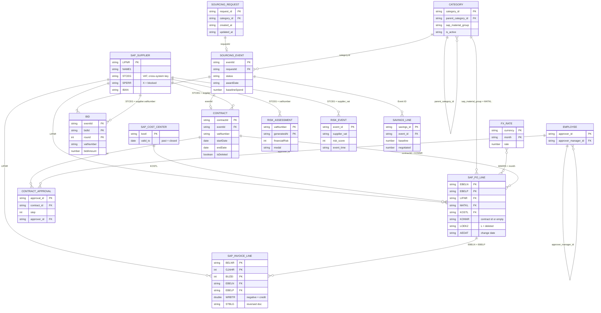
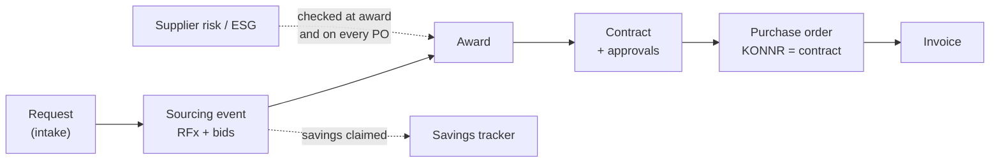

# Source data model (ER diagram)

How the source entities relate **before** any cleaning. Keys are the source systems' own keys. The two important cross-system joins are marked:

- **Ariba → SAP supplier:** there is no shared ID. Match on **VAT number** (`supplier.vatNumber` = `STCEG`). This is `int_supplier_mapping` in dbt.
- **PO → contract:** `KONNR` holds the Ariba contract ID. Empty means the purchase had no contract (maverick spend).

## The S2C chain

Cycle time (request → award), spend under contract (PO with `KONNR`), savings (baseline − awarded) and risk exposure (spend with High-risk suppliers) all come from walking this chain.
